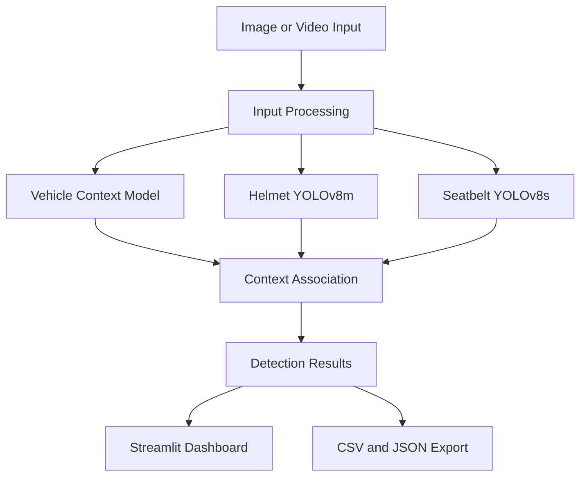

# TrafficGuard AI
Intelligent Helmet and Seatbelt Detection System

## Overview
TrafficGuard AI is a computer vision project developed to identify helmet and seatbelt usage in traffic images and videos. The system uses two independently trained YOLOv8 object detection models and a pretrained vehicle-context model. A Streamlit application provides image detection, video processing, CSV-based batch detection, and model performance visualization.

This project is an academic prototype and is not intended for automatic traffic enforcement.

## Live Demonstration

TrafficGuard AI is deployed on Streamlit Community Cloud.

[Open TrafficGuard AI](https://traffficguard-ai.streamlit.app/)

The application supports helmet detection, seatbelt detection,
combined inference, image and video processing, CSV-based
batch detection and model performance visualization.

## Features
- Helmet detection
- Seatbelt detection
- Combined traffic detection
- Motorcycle and vehicle context association
- Multiple inference profiles
- Image and video upload
- CSV-based batch processing
- Annotated detection results
- CSV and JSON result export
- Model performance dashboard
- CPU and GPU inference support

## System Architecture


## Models
| Task | Architecture | Image Size | Confidence |
| :--- | :--- | :---: | :---: |
| Helmet detection | YOLOv8m | 640 | 0.30 |
| Seatbelt detection | YOLOv8s | 640 | 0.35 |
| Vehicle context | YOLOv8n | 640 | 0.25 |

## Independent Test Results
| Metric | Helmet | Seatbelt |
| :--- | :---: | :---: |
| Precision | 64.38% | 91.37% |
| Recall | 71.13% | 88.60% |
| Macro F1 | 67.42% | 89.94% |
| mAP50 | 72.22% | 92.93% |
| mAP50-95 | 38.17% | 60.16% |
| Violation F1 | 61.92% | 87.70% |
| Test images | 154 | 781 |

These values are standard object detection metrics obtained from the reserved test splits, not classification accuracy.

## Installation
1. Clone the repository.
2. Create and activate a Python virtual environment.
3. Install the dependencies:
   ```bash
   python -m pip install -r requirements.txt
   ```
4. Run the Streamlit application:
   ```bash
   python -m streamlit run streamlit_app.py
   ```
5. Open `http://localhost:8501` in your browser.

## Inference Profiles
- Standard
- High resolution
- Maximum resolution
- High sensitivity
- Region assisted

`Standard` is the default evaluated configuration. Alternative profiles are experimental.

## Dataset Information
See `datasets/README.md` for dataset sources, class mappings, preprocessing, and dataset limitations.

## Project Structure
- `app/`: Streamlit frontend
- `src/`: AI inference and video processing
- `models/`: Final trained weights
- `configs/`: Application configuration
- `notebooks/`: Development and training notebooks
- `results/`: Evaluation and system testing results
- `docs/`: Technical documentation
- `tests/`: Software verification scripts

## Limitations
- Helmet detection is less reliable for distant or blurred riders.
- Helmet dataset annotations include cyclists and some non-riders.
- Vehicle context association uses spatial heuristics.
- Seatbelt visibility is affected by lighting and windshield reflections.
- Video statistics count detection instances, not unique violations.
- Complete source-level independence cannot be guaranteed for all datasets.
- All possible violations require human review.

## Technologies
Python, PyTorch, Ultralytics YOLOv8, OpenCV, Streamlit, NumPy, Pandas, Matplotlib, Google Colab, and Kaggle.

## Acknowledgements
This project uses Ultralytics YOLO and publicly available helmet and seatbelt detection datasets.
The initial project reference was:
https://github.com/Moeez002/Helmet-Seatbelt-Detection

Third-party code and data remain subject to their respective licenses.

## License
See the applicable project and third-party licensing information.
